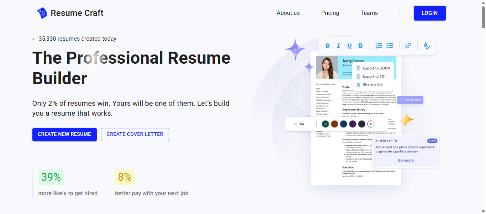
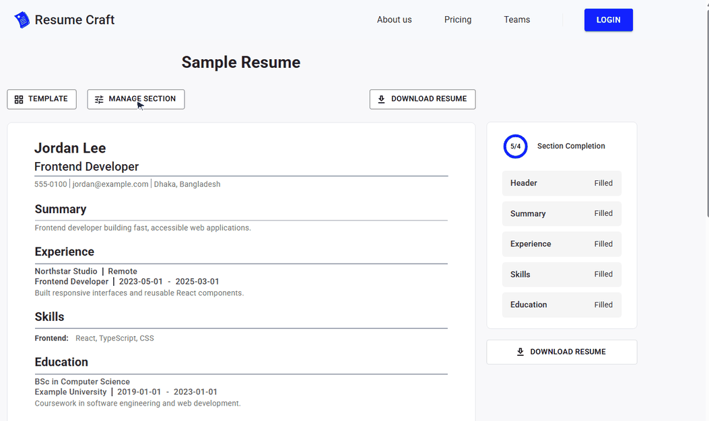

# Resume Craft

**Build your resume. Tell your story.**



[](https://resume-craft-web.vercel.app/)
[](https://github.com/touhidcodes/Resume-Craft/issues)
[](LICENSE.txt)

## Table of contents

- [Project overview](#project-overview)
- [MVP and key features](#mvp-and-key-features)
- [Technology stack](#technology-stack)
- [Installation](#installation)
- [API reference](#api-reference)
- [Development challenges](#development-challenges)
- [Contributing](#contributing)
- [Future direction](#future-direction)
- [Team and contact](#team-and-contact)
- [License](#license)

## Project overview

- **Objective:** Build a feature-rich, easy-to-use online resume builder that helps people create professional, visually appealing application documents.
- **Target Audience:** Job seekers, students, and professionals across industries.

| Problem                                                                     | How Resume Craft addresses it                                                                 |
| --------------------------------------------------------------------------- | --------------------------------------------------------------------------------------------- |
| Starting from a blank page makes it hard to structure a resume.             | Templates provide editable sections for experience, education, skills, and more.              |
| Tailoring a resume for each role can mean reformatting the entire document. | Live previews, template switching, and section reordering let users see changes as they work. |
| Application files become difficult to track and reuse.                      | A dashboard keeps saved resumes and cover letters together for editing and duplication.       |

**Unique selling point (USP):** Users can build both documents, reuse a saved version for a new application, and export PDFs from the same workspace.

## MVP and key features

### Resume Builder

- Create a professional resume in minutes with **5+ customizable templates** for different roles and industries.
- Add and edit sections such as work experience, education, and skills, then **drag and drop** them to change their order. See updates instantly in **Live Preview**.
- Export your resume as a **PDF** using the browser’s **Save as PDF** option.



### Cover Letter Builder

- Start with a customizable cover letter template.
- Tailor the recipient details, letter body, and closing to each role.
- Export your cover letter as a **PDF** using the browser’s **Save as PDF** option.

### User Dashboard

- Keep saved resumes and cover letters in one place.
- Reopen and edit documents as your experience or application changes.
- Duplicate a saved document to tailor a copy for another role.

### Admin Dashboard

- Restrict access to administrators through role-based routing.
- Manage resume and cover letter templates.
- Review user and document totals, popular templates, and monthly resume activity.

### Free Plan and Pricing

- The intended free allowance is **up to 10 resumes and cover letters per account**.
- The template pickers in this checkout currently use a limit of **10 per document type**.
- The [pricing page](https://resume-craft-web.vercel.app/pricing) shows free and planned paid tiers. Subscription checkout is marked **Coming Soon**.

## Technology stack

| Technology                   | Why we use it                                                                                                                                          |
| ---------------------------- | ------------------------------------------------------------------------------------------------------------------------------------------------------ |
| React, TypeScript, and Vite  | React supports reusable editors and templates. TypeScript defines shared document shapes, and Vite provides the development server and frontend build. |
| React Router                 | Organizes public pages, document builders, and role-based dashboard routes.                                                                            |
| Redux Toolkit and RTK Query  | Redux Toolkit keeps document state available to the editor and preview. RTK Query manages requests to the hosted API.                                  |
| Tailwind CSS and Material UI | Tailwind supports responsive layouts, and Material UI provides reusable interface controls.                                                            |
| Firebase and JWT             | Firebase supports authentication integration, and the frontend sends the session token with API requests.                                              |
| dnd-kit and react-to-print   | dnd-kit handles resume section reordering. react-to-print opens the browser print dialog for export.                                                   |
| Vercel                       | Hosts the frontend and serves client-side routes on direct visits.                                                                                     |

## Installation

### Prerequisites

- Git
- Node.js 20.x, as specified in `package.json`, with npm

### Start the frontend

```bash
git clone https://github.com/touhidcodes/Resume-Craft.git
cd Resume-Craft
npm ci
npm run dev
```

Open [http://localhost:5173](http://localhost:5173/) or the URL printed by Vite. Create an account or sign in to try the document workflow.

### API configuration

The frontend uses the hosted Resume Craft API by default. See the [API reference](#api-reference) for endpoints. The default setup requires no local API server, database, or environment variables. Sign-in, saved documents, and dashboard data depend on the hosted services being reachable.

For a separate API instance, set `baseUrl` in [`src/redux/api/baseApi.ts`](src/redux/api/baseApi.ts) to that instance’s API root. The API must allow requests with credentials from your local Vite URL.

### Available scripts

| Command           | What it does                                                      |
| ----------------- | ----------------------------------------------------------------- |
| `npm run dev`     | Start the Vite development server.                                |
| `npm run lint`    | Check the project with ESLint.                                    |
| `npm run build`   | Run TypeScript checks and create a production build in `dist/`.   |
| `npm run preview` | Serve the production build locally after running `npm run build`. |

## API reference

[Backend repository · Resume Craft Server](https://github.com/touhidcodes/Resume-Craft-Server)

**Base URL:** `https://resume-craft-api.vercel.app/api`. Append the paths below to this URL. The [frontend API client](src/redux/api/baseApi.ts) sends the session token as `Authorization: <token>` when one is available. Path parameters such as `{id}` refer to the resource being requested.

<details>
<summary>Auth, profile, resume, cover letter, and template endpoints</summary>

| Area          | Method   | Path                                               | Purpose                                        |
| ------------- | -------- | -------------------------------------------------- | ---------------------------------------------- |
| Auth          | `POST`   | `/auth/login`                                      | Sign in with account credentials               |
| Auth          | `POST`   | `/user/register`                                   | Register an account                            |
| Auth          | `POST`   | `/user/register-google`                            | Submit Google sign-in details to the API       |
| Profile       | `GET`    | `/user/profile`                                    | Get the signed-in profile                      |
| Profile       | `PUT`    | `/user/profile`                                    | Update the signed-in profile                   |
| Resumes       | `GET`    | `/resume/resumes`                                  | List saved resumes                             |
| Resumes       | `GET`    | `/resume/resume/{id}`                              | Get a resume and its section completion status |
| Resumes       | `POST`   | `/resume/create-resume`                            | Create a resume                                |
| Resumes       | `POST`   | `/resume/create-resume-duplicate/{id}`             | Duplicate a resume                             |
| Resumes       | `PATCH`  | `/resume/update-resume/{id}`                       | Update a resume, including its section order   |
| Resumes       | `DELETE` | `/resume/delete-resume/{id}`                       | Delete a resume                                |
| Cover letters | `GET`    | `/cover-letter/cover-letters`                      | List saved cover letters                       |
| Cover letters | `GET`    | `/cover-letter/{id}`                               | Get a cover letter                             |
| Cover letters | `POST`   | `/cover-letter/create-cover-letter`                | Create a cover letter                          |
| Cover letters | `POST`   | `/cover-letter/create-cover-letter-duplicate/{id}` | Duplicate a cover letter                       |
| Cover letters | `PATCH`  | `/cover-letter/update-cover-letter/{id}`           | Update a cover letter                          |
| Cover letters | `DELETE` | `/cover-letter/delete-cover-letter/{id}`           | Delete a cover letter                          |
| Templates     | `GET`    | `/template/templates`                              | List resume templates                          |
| Templates     | `GET`    | `/cover-letter-template/templates`                 | List cover letter templates                    |

</details>

<details>
<summary>Resume section and admin endpoints</summary>

| Resume section  | Create (`POST`)                              | Update (`PATCH`)                                  | Delete (`DELETE`)                                 |
| --------------- | -------------------------------------------- | ------------------------------------------------- | ------------------------------------------------- |
| Work experience | `/resume/work-experience/create-experience`  | `/resume/work-experience/update-experience/{id}`  | `/resume/work-experience/remove-experience/{id}`  |
| Skills          | `/resume/skill/create-skill`                 | `/resume/skill/update-skill/{id}`                 | `/resume/skill/remove-skill/{id}`                 |
| Education       | `/resume/education/create-education`         | `/resume/education/update-education/{id}`         | `/resume/education/remove-education/{id}`         |
| Certifications  | `/resume/certification/create-certification` | `/resume/certification/update-certification/{id}` | `/resume/certification/remove-certification/{id}` |
| Awards          | `/resume/award/create-award`                 | `/resume/award/update-award/{id}`                 | `/resume/award//remove-award/{id}`                |

The awards deletion path includes a double slash in the current client.

| Method   | Admin path                                    | Purpose                        |
| -------- | --------------------------------------------- | ------------------------------ |
| `GET`    | `/user/all-profile`                           | List user profiles             |
| `GET`    | `/analytics/admin-dashboard-data`             | Get dashboard analytics        |
| `POST`   | `/template/create-template`                   | Create a resume template       |
| `DELETE` | `/template/remove-template/{id}`              | Delete a resume template       |
| `POST`   | `/cover-letter-template/create-template`      | Create a cover letter template |
| `DELETE` | `/cover-letter-template/remove-template/{id}` | Delete a cover letter template |

</details>

## Development challenges

| Challenge                                             | Solution                                                                                     |
| ----------------------------------------------------- | -------------------------------------------------------------------------------------------- |
| Keeping editable fields and the live preview in sync  | The editor and templates read shared document state so changes are reflected as users type.  |
| Handling edits and duplicates for both document types | The dashboard offers separate actions for updating an existing document and creating a copy. |

## Contributing

### Pull request workflow

1. If you find a bug or another problem, [submit a GitHub issue](https://github.com/touhidcodes/Resume-Craft/issues/new). Include steps to reproduce it, what you expected, and what happened.
2. Fork the [repository](https://github.com/touhidcodes/Resume-Craft), clone your fork, and create a branch from upstream `dev`. Replace `YOUR_GITHUB_USERNAME` with your GitHub username.

   ```bash
   git clone https://github.com/YOUR_GITHUB_USERNAME/Resume-Craft.git
   cd Resume-Craft
   git remote add upstream https://github.com/touhidcodes/Resume-Craft.git
   git fetch upstream
   git switch -c docs/improve-readme upstream/dev
   npm ci
   ```

3. Make a focused change. Run `npm run lint` and `npm run build`. For UI changes, try the affected flow locally and capture screenshots when they help the reviewer.
4. Stage the files for your change, commit, and push the branch. For a README-only change, use the following commands.

   ```bash
   git add README.md
   git commit -m "docs: clarify local setup"
   git push -u origin docs/improve-readme
   ```

5. Open a pull request from your fork against `touhidcodes/Resume-Craft:dev`. Describe what changed, how you verified it, and any issue it resolves.

### Commit message format

Use `type(scope): short imperative summary`. The scope is optional. Common types include `feat`, `fix`, `docs`, `refactor`, and `chore`.

```text
feat(resume): add a skills section
fix(export): preserve PDF margins
docs: clarify local setup
```

## Future direction

- Add role-specific templates and test how applicant tracking systems parse exported PDFs.
- Add autosave and version history so users can recover earlier drafts.
- Improve keyboard navigation and small-screen editing.
- Add subscription checkout for the plans shown on the pricing page.

## Team and contact

| Contributor    | Role                          | Contribution                                                               |
| -------------- | ----------------------------- | -------------------------------------------------------------------------- |
| Touhidur Zaman | Team lead and GitHub manager  | Coordinated the project and managed the repository.                        |
| MD Rifat       | Co-lead and backend developer | Designed the backend APIs and system architecture.                         |
| Imtiaz Tamim   | Backend developer             | Contributed to API development and database management.                    |
| Emon Ahmed     | Frontend developer            | Built responsive components and optimized frontend performance.            |
| Rakib Ahmed    | Frontend developer            | Developed user-facing features and worked on cross-platform compatibility. |
| Nur Muhammad   | Frontend developer            | Implemented frontend functionality and styled components.                  |

[LinkedIn](https://www.linkedin.com/in/touhidur-zaman/) · [Email Touhidur Zaman](mailto:touhidcodes@gmail.com)

## License

Resume Craft is licensed under the [MIT License](LICENSE.txt).
